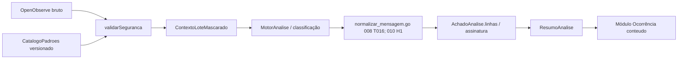

# Data Model: Mascarar dados sensíveis

**Feature**: `010-mascarar-dados-sensiveis` | **Date**: 2026-11-16

Entidades lógicas do mascaramento no Finder. Persistência da **Ocorrência** fica no Módulo (T1 revisto). Tipos Go concretos **NEEDS CLARIFICATION** (sem código nesta fase).

---

## ContextoLoteMascarado

Representa o lote **após** `montarContexto()` e **antes** do MotorAnalise/classificação.

| Campo | Obrig. | Descrição | Fonte |
|-------|--------|-----------|-------|
| `batchId` | sim | Identificador do lote `log.ingested` | contrato-log-ingested-v1.txt; 010-15 A |
| `linhas` | sim | `LinhaLogMascarada[]` — uma entrada por linha de log do lote | 010-14 C; ADR_011 |
| `versaoCatalogo` | sim | Versão do artefato de padrões usado nesta execução | 010-19 A; FR-008 |
| `dadosSensiveisIdentificados` | sim | Contagem total de ocorrências de padrão aplicado no lote | 010-17; ADR_064 retorno |
| `falhaSeguranca` | não | Verdadeiro se `validarSeguranca()` falhou (010-16 C) | 010-16 C |

**Regras**:

- Produzido **uma vez** por lote válido (010-15 A).
- Se `falhaSeguranca`, achados subsequentes MUST usar `linhas` vazias ou omitir trechos (FR-010).
- Texto bruto do lote **não** é exposto fora do adaptador OpenObserve (010-24 C).

---

## LinhaLogMascarada

Unidade de mascaramento (linha a linha).

| Campo | Obrig. | Descrição | Fonte |
|-------|--------|-----------|-------|
| `texto` | sim | Linha após substituição/remoção; pode conter placeholder de e-mail ou marcador de omissão | FR-006; 010-10/010-11 |
| `indiceLinha` | recomendado | Ordem no lote/arquivo para rastreio e exemplos | ADR_011; E08.F1.3 (exemplos) |
| `linhaRemovida` | não | Verdadeiro quando a linha foi trocada integralmente por marcador de segredo | FR-006; ADR_064 |

**Fora de `LinhaLogMascarada` (DN-010-2)**: atributos OTel do registro **não** entram em `validarSeguranca()`; identificadores copiados para Ocorrência conforme **ADR_040** permanecem **como enviados** (fonte: respostas-joao.md, DN-010-2; origem: respostas-etapa3.md §8, spec.md FR-004a).

**Validação (com catálogo vigente)**:

- Linha com padrão senha/token/secret catalogado → `texto` MUST ser exatamente `"log com senha omitido"` (010-10 A).
- E-mail catalogado → `texto` MUST substituir o e-mail por placeholder fixo acordado na ADR (010-11 A; string exata **NEEDS CLARIFICATION**).
- Padrão não catalogado → `texto` igual ao bruto (010-13 A).

---

## ResultadoValidarSeguranca

Retorno lógico de `validarSeguranca()` / `ScannerSegurança` (nomes ADR; FR-007).

| Campo | Tipo | Descrição | Fonte |
|-------|------|-----------|-------|
| `linhasMascaradas` | `string[]` ou `LinhaLogMascarada[]` | Saída linha a linha | ADR_064; FR-006 |
| `totalSensivel` | int | Alimenta `dadosSensiveisIdentificados` | 010-17; ADR_064 |
| `erro` | opcional | Falha de processamento — aciona 010-16 C | 010-16 C |

---

## MarcadorOmisso

Valor fixo de negócio.

| Constante | Valor | Fonte |
|-----------|-------|-------|
| Texto linha senha/token/secret | `"log com senha omitido"` | respostas-joao.md, 010-10 A; spec FR-006 |

---

## PlaceholderEmail

| Campo | Valor | Fonte |
|-------|-------|-------|
| Forma | Texto fixo (ex. `[email]` na spec) | 010-11 A |
| Valor canônico | **NEEDS CLARIFICATION** — definido na ADR P-010-2 | 010-2 A; ADR_064 [PENDENTE] |

---

## CatalogoPadroes (artefato versionado)

Artefato compartilhado Finder + Sugestão (FR-008). **Conteúdo** definido na ADR — não duplicado aqui.

| Campo | Obrig. | Descrição | Fonte |
|-------|--------|-----------|-------|
| `versao` | sim | Semântica de versão; Finder e Sugestão MUST coincidir em deploy; na **inicialização**, versão lida MUST bater com versão **combinada** ou o serviço **não sobe** (**DN-010-3 B**) | 010-19 A; DN-010-3 B |
| `padroes` | sim | Lista de regras/regex — **[PENDENTE ADR 010-2]** | 010-1; P-010-2 |
| `marcadorLinhaSegredo` | sim | Deve alinhar a `MarcadorOmisso` | 010-10 A |
| `placeholderEmail` | sim | Deve alinhar a `PlaceholderEmail` quando ADR fechar | 010-11 A |

**Path e formato**: declarados na **ADR da lista** (**DN-010-4 C**, **010-2 A**); valores concretos **aguardam P-010-2** — esta spec **não** inventa caminho nem serialização (fonte: respostas-joao.md §Etapa 3c, João 16/11 11h; respostas-etapa3c.md §8).

---

## Integração com `AchadoAnalise` e `ResumoAnalise`

Alinhado à spec 009 / 006 (somente campos tocados pelo mascaramento).

### AchadoAnalise

| Campo | Relação com 010 | Fonte |
|-------|-----------------|-------|
| `linhas` | MUST conter apenas strings já mascaradas; vazio se 010-16 C | 010-6; 010-21; FR-003 |
| `assinatura` / campos N3 | Agrupamento (008); normalização da mensagem **DN-008-4 B** (trim, case-insensitive, marcadores número/UUID/IP/data/hex) via normalizador canônico `normalizar_mensagem.go` (**008**, **T016**) — **010 H1**: a **010** MUST **invocar** esse artefato e MUST NOT duplicar o algoritmo; entrada MUST ser mensagem **mascarada** (**FR-015**). Literais **DN-008-5 A**: `<NUM>` `<UUID>` `<IP>` `<DATE>` `<HEX>` (dono **008**; ≠ `"log com senha omitido"`). Composição textual da assinatura (separador **DN-008-8 A**, escape **DN-008-9 A**) — dona spec **008**, não documentada aqui. Campos N3 [PENDENTE ADR] **N3 A** | N3 A; **010 H1**; DN-008-4 B; DN-008-5 A; FR-015 |
| Demais campos | Classificação (006); não alterados por esta feature além de consumir texto mascarado | T6 A |

### ResumoAnalise.contadores

| Conceito | Significado | Fonte |
|----------|-------------|-------|
| **`dadosSensiveisIdentificados`** (lote/contexto) | Total numérico retornado por `validarSeguranca()` | ADR_064; 010-17; spec Clarifications **I2** |
| Rótulo humano nos contadores | **“dados sensíveis mascarados”** | 010-17; ADR_102 |
| Chave JSON no handoff `[INFERIDO]` | Ex.: `contadores.dadosSensiveisMascarados` — alinhada a ADR_102 até ADR fechar lista | analyze **I2**; [saida-mascarada-handoff.md](./contracts/saida-mascarada-handoff.md) |
| Campo achado no Drive | **`dadosSensiveis`** (distinct; aguarda ADR/N3) | revisao-T1-drive.md; FR-005 |

Ver glossário **I2** em [spec.md](./spec.md) Clarifications (etapa 3c).

---

## Ocorrencia.conteudo (Módulo — referência)

| Campo | Origem | Fonte |
|-------|--------|-------|
| `conteudo` | Copia/persiste `AchadoAnalise.linhas` recebidas | 010-25; ADR_040 |

Finder **não** grava este campo (T1 revisto).

---

## Fluxo (entidades)

---

## Fontes consolidadas

- (fonte: spec.md FR-001–FR-011, Key Entities)
- (fonte: respostas-joao.md, 010-10 A / 010-16 C / 010-18 A / 010-19 A)
- (fonte: revisao-T1-drive.md, 010-17 / 010-25)
- (fonte: respostas-documentadas.md, 010-3–010-15)
- (fonte: respostas-joao.md, 010 H1; origem: §Etapa 3g, João 16/11 13h22, DN-008-4 B, FR-015)